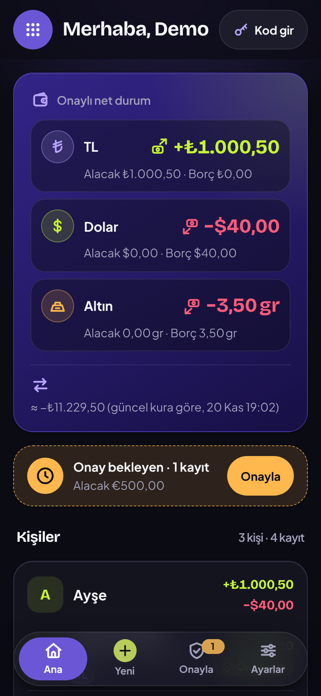
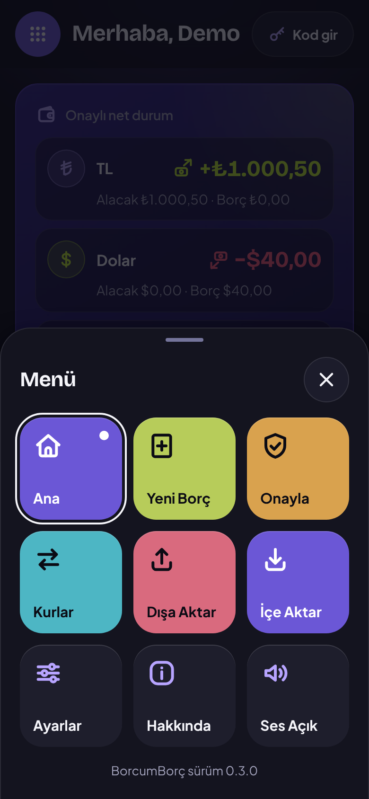
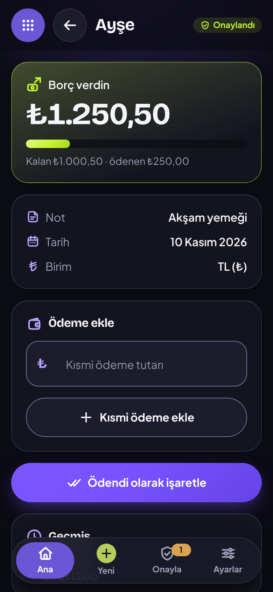

<p align="center">
  
</p>

<p align="center"><b>Borç, karşılıklı onayla.</b></p>

# BorcumBorç

İki kişi arasındaki borcu **internetsiz** ve **karşılıklı onayla** kaydeden sade bir borç defteri.

Kayıt, yalnızca karşı taraf onayladığında geçerli sayılır. Veriler telefonunda durur, bir sunucuya gönderilmez.

<p align="center">
  
  &nbsp;
  
  &nbsp;
  
</p>
<p align="center"><sub>Ana ekran · Izgara menü · Borç detayı (örnek verilerle)</sub></p>

## Ne yapar?

- Borç ve alacak kaydı tutar (kişi, tutar, tarih, not).
- Her kayıt için bir **Onay Kodu** üretir. Karşı taraf bu kodu kendi telefonunda onaylar ve bir **Yanıt Kodu** döndürür. Yanıt Kodu girilince kayıt "Onaylandı" olur.
- Kodu WhatsApp, Telegram, e-posta ya da başka bir uygulamayla paylaşmak tek dokunuş.
- Kısmi ödemeleri ve "Ödendi" durumunu izler.
- Toplam alacak ve borç durumunu ana ekranda para birimi bazında gösterir: TL, dolar, euro ve altın.
- Dolar, euro ve altın kurunu internetten otomatik alır; ₺ karşılığını gösterir.
- Verileri JSON olarak dışa ve içe aktarır.
- İnternet olmadan çalışır.

## Yenilikler (v0.3)

- Baştan tasarlanan arayüz: koyu mürekkep zemin, mor ve limon vurgular, büyük kart ve rakamlar.
- Her ekranda sol üstte **ızgara menü**: Ana, Yeni Borç, Onayla, Kurlar, Dışa Aktar, İçe Aktar, Ayarlar, Hakkında ve Ses.
- Yeni **BB logosu**: iki B'nin kesiştiği yerde doğan limon bağ, karşılıklı onayı anlatır.
- Yenilenen açılış ekranı ve animasyonu.
- Baştan yazılan ses efektleri: yumuşak, kısa, tek bir ses ailesi. Ayarlardan kapatılabilir.
- iOS paketi için derleme akışı ve kurulum rehberi.

Ayrıntılar: [`docs/v0.3-tasarim-brief.md`](docs/v0.3-tasarim-brief.md), [`web/assets/brand.md`](web/assets/brand.md).

## Durum

Bu sürüm bir **prototiptir**.

| Özellik | Durum |
| --- | --- |
| Borç kaydı, liste, ödeme takibi | Hazır |
| Kod ile karşılıklı onay | Hazır |
| Çevrimdışı çalışma | Hazır |
| Android APK (debug imzalı) | Hazır |
| iOS paketi (Xcode projesi ve derleme akışı) | Hazır, imzalı `.ipa` için Apple hesabı gerekir |
| Bluetooth ile telefonlar arası eşleşme | Sonraki sürüm |
| Mağaza imzalı (release) APK | Sonraki sürüm |

## Android: APK indirme

Her `main` dalı güncellemesinde GitHub Actions bir Android APK derler ve **Releases** sayfasındaki `son-surum` sürümüne `BorcumBorc.apk` olarak koyar.

1. Telefonda bu deponun **Releases** sayfasını aç.
2. `BorcumBorc.apk` dosyasını indir.
3. Dosyayı açıp kurulum iznini ver.

Not: Bu APK "debug" imzalıdır. Kurulumda bilinmeyen kaynak uyarısı çıkabilir.

## iOS

APK yalnızca Android içindir. iOS'un karşılığı `.ipa` dosyasıdır ve Apple kuralları gereği ücretli Apple Developer hesabıyla imzalanmalıdır (yılda 99 USD).

- **Üyelik olmadan:** iPhone'da Safari ile web sürümünü aç, Paylaş > **Ana Ekrana Ekle**. Titreşim bu yolla çalışmaz.
- **Üyelikle:** **Actions > iOS derleme** akışı imzalı `.ipa` üretir. Gerekli adımlar: [`docs/ios-kurulum.md`](docs/ios-kurulum.md).
- **Mac'te Xcode ile:** Depoyu klonla, `npm install`, `npx cap add ios`, `npx cap open ios`.

## Web sürümü

`web/` klasörü uygulamanın tamamıdır ve tarayıcıda da çalışır. GitHub Pages için **Actions → Web sayfası (GitHub Pages) → Run workflow** çalıştırılır.

## Geliştirme

```
npm install
node --test tests/logic.test.js     # mantık ve kontrast testleri
cd web && python3 -m http.server    # tarayıcıda dene
```

## Yapı

```
web/          Uygulama (HTML, CSS, JS, yazı tipleri, logo)
resources/    Uygulama ikonu ve açılış ekranı kaynakları
docs/         Tasarım özeti, iOS rehberi, ekran görüntüleri
tests/        Mantık ve kontrast testleri
.github/      Android, iOS ve Pages derleme akışları
```

Paketleme Capacitor ile yapılır. `android/` ve `ios/` klasörleri derleme sırasında üretilir ve depoya konmaz.

## Tasarım

Koyu mürekkep zemin (`#0B0B14`), elektrik moru ana eylem, limon (alacak) ve mercan (borç) vurgusu, Plus Jakarta Sans ve Bricolage Grotesque yazı tipleri. Tüm metin ve zemin çiftleri WCAG AA kontrastını geçer.
